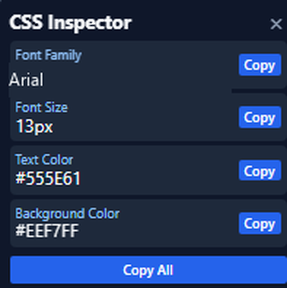

# DevEye

A lightweight Chrome extension for inspecting computed CSS styles on webpage elements.

[](./LICENSE)
[](./manifest.json)
[](https://developer.mozilla.org/docs/Web/JavaScript)
[](https://developer.chrome.com/docs/extensions/develop/migrate/what-is-mv3)
[](https://github.com/M003aad/DevEye/actions/workflows/ci.yml)

## Table of Contents

- [Overview and architecture](#overview-and-architecture)
- [Features](#features)
- [Screenshots](#screenshots)
- [Codebase breakdown](#codebase-breakdown)
- [Permissions](#permissions)
- [Installation and setup](#installation-and-setup)
- [Usage](#usage)
- [Messaging and API reference](#messaging-and-api-reference)
- [Scripts](#scripts)
- [Contributing](#contributing)
- [Security](#security)
- [License](#license)

## Overview and architecture

DevEye is a Chrome extension built with vanilla JavaScript, HTML, and CSS using Chrome Extension Manifest V3. It has no framework, bundler, backend, or background service worker. The extension is intended for Chrome; compatibility with other browsers has not been verified.

The popup in `popup.html` and `popup.js` lets the user enable or disable inspection. `manifest.json` injects `content.js` and `content.css` into matching webpages. The content script reads computed styles and displays the inspector interface in a Shadow DOM, styled by `overlay.css` so page styles do not affect the overlay. The enabled state is stored with `chrome.storage.local`.

## Features

- Enable or disable the inspector from the extension popup.
- Highlight the element under the pointer.
- Display the primary font family, font size, text color, and background color in a floating tooltip.
- Click an element to open an in-page panel with its computed CSS properties.
- Copy an individual property or all displayed properties.
- Close the panel with its close button or by clicking outside it.
- Keep the inspector interface isolated from webpage CSS with Shadow DOM.
- Persist the enabled state locally with `chrome.storage.local`.

## Screenshots



The screenshot is cropped to the inspector panel; webpage content and site-specific font details are omitted.

## Codebase breakdown

```text
DevEye/
├── .github/
│   ├── ISSUE_TEMPLATE/
│   ├── workflows/
│   └── PULL_REQUEST_TEMPLATE.md
├── assets/
│   ├── 16.png
│   ├── 32.png
│   ├── 48.png
│   └── 128.png
├── screenshots/
│   └── inspector-example.png
├── scripts/
│   └── validate-extension.js
├── .editorconfig
├── .gitattributes
├── .gitignore
├── .prettierrc
├── CHANGELOG.md
├── CITATION.cff
├── CODE_OF_CONDUCT.md
├── CONTRIBUTING.md
├── content.css
├── content.js
├── eslint.config.js
├── LICENSE
├── manifest.json
├── overlay.css
├── package.json
├── package-lock.json
├── popup.html
├── popup.js
├── README.md
├── SECURITY.md
├── SUPPORT.md
└── SUMMARY.md
```

| Path | Purpose |
| --- | --- |
| `assets/` | Extension icons at the sizes used by the manifest and popup. |
| `screenshots/` | Example screenshots of the inspector on webpages. |
| `.github/` | Issue and pull request templates, plus CI and release workflows. |
| `scripts/validate-extension.js` | Checks the manifest and referenced extension files. |
| `content.js` | Handles inspection, style extraction, overlay UI, and content-script messaging. |
| `content.css` | Styles the inspected page element highlight. |
| `overlay.css` | Styles the inspector UI inside its Shadow DOM. |
| `manifest.json` | Declares the Manifest V3 extension metadata, permissions, icons, and content scripts. |
| `popup.html`, `popup.js` | Popup UI and logic for toggling the inspector. |
| `package.json`, `package-lock.json` | Development scripts and locked linting dependencies. |
| `LICENSE` | GNU Affero General Public License, version 3. |

## Permissions

| Manifest entry | Type | Purpose |
| --- | --- | --- |
| `storage` | Permission | Saves and reads the inspector's enabled state using `chrome.storage.local`. |
| `activeTab` | Permission | Supports popup interaction with the active tab. |
| `<all_urls>` | Content-script match pattern | Injects the inspector content script and highlight stylesheet on matching webpages. |

## Installation and setup

### Load the extension in Chrome

1. Clone the repository:

   ```sh
   git clone https://github.com/M003aad/DevEye.git
   cd DevEye
   ```

2. Install the development dependencies:

   ```sh
   npm ci
   ```

3. Check the source and extension manifest:

   ```sh
   npm run lint
   npm run build
   ```

   The project has no bundling step; `build` validates the manifest and the files it references.

4. Open `chrome://extensions/` in Chrome and enable **Developer mode**.
5. Select **Load unpacked** and choose the cloned `DevEye` directory.
6. Open a regular webpage and click the DevEye toolbar icon.

After changing extension files, reload DevEye from `chrome://extensions/` and refresh the webpage.

## Usage

1. Open the DevEye popup and turn the inspector on.
2. Move the pointer over an element to highlight it and view its computed styles in the tooltip.
3. Click an element to open the CSS properties panel.
4. Use **Copy** beside a property or **Copy All**.
5. Close the panel with **×** or click outside it. The current inspection session is then disabled; turn it on again from the popup to inspect more elements.

The font-family value is shortened to its primary family when fallback fonts are present.

## Messaging and API reference

The popup sends a message to the active tab's content script with `chrome.tabs.sendMessage`. The content script listens with `chrome.runtime.onMessage` and responds with its current enabled state.

| Name | Direction | Payload | Response |
| --- | --- | --- | --- |
| `DEVEYE_SET_ENABLED` | Popup → content script | `{ "type": "DEVEYE_SET_ENABLED", "enabled": true }` (or `false`) | `{ "enabled": true }` (or `false`) |

Example request:

```json
{
  "type": "DEVEYE_SET_ENABLED",
  "enabled": true
}
```

The popup also reads and writes the `enabled` value in `chrome.storage.local`. No external HTTP API or backend route is used.

## Scripts

| Command | Description |
| --- | --- |
| `npm run lint` | Lints the popup and content scripts with ESLint. |
| `npm run build` | Validates `manifest.json` and the extension files referenced by it; no bundle is generated. |

## Contributing

Bug reports, feature proposals, and pull requests are welcome. See [CONTRIBUTING.md](./CONTRIBUTING.md) for the local setup and contribution standards.

## Security

Please report suspected vulnerabilities privately. See [SECURITY.md](./SECURITY.md) for the reporting process and response expectations.

## License

DevEye is licensed under the [GNU Affero General Public License v3.0](./LICENSE). The project author and maintainer is M003aad.
